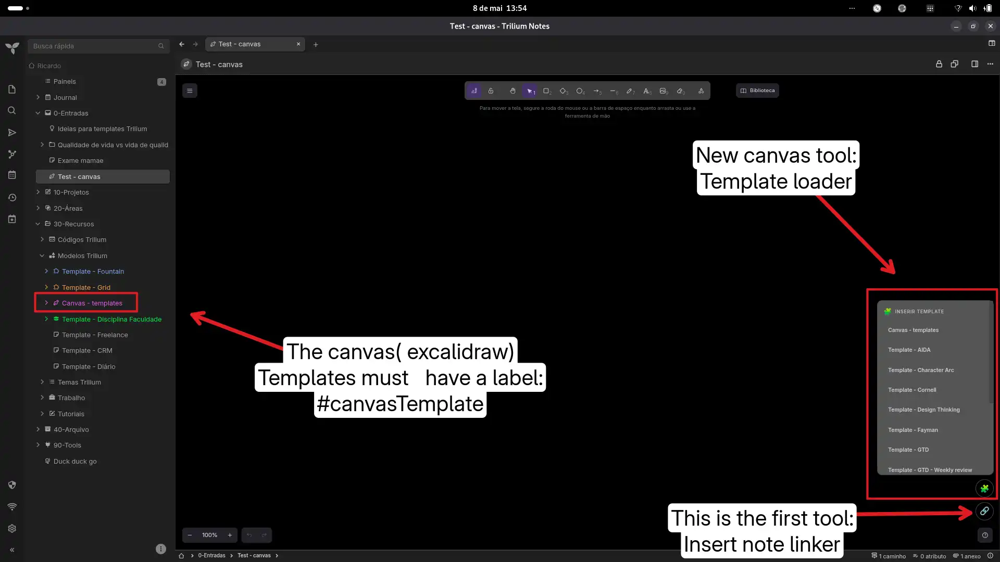

# Canvas Template Loader Widget

> ⚠️ **INCORPORADO ao Canvas Note Tools (v8, set/2026).** Este script foi
> fundido no [Canvas Note Tools](../Canvas-Note-Tools/README.md) — botão 🧩 na
> toolbar, com remapeamento correto de ids/referências na inserção. A nota
> "Canvas Templater" pode ser removida do Trilium (a pasta fica só como
> histórico/referência).

> 🔍 **Auditado na rodada 14 (17/10/2026) — veredito: ARQUIVAR, nada a corrigir.**
> `bun build` OK; sha256 do zip **idêntico** ao do repo
> (`8f4a8a7afdde4d57ca3e0bc251149be213e8b8f60fe3e14335f206a8253d84cd`); sem manifest
> e sem entrada no `registry.json`; a nota já **não existe** no Trilium da VPS.
> O v8 cobre 100% e já corrige os achados críticos/altos deste arquivo (canvas
> ilegível sobrescrito, clonagem sem remap de `boundElements`/bindings/grupos,
> título injetado em `innerHTML`, a11y, i18n, cache, posição). Relatório:
> `../AUDITORIA-ESPECIALISTAS.md` § Rodada 14; residual em
> `../ROADMAP-RESIDUAIS.md` § Canvas-Template-Loader.

A lightweight template system for Trilium Canvas. Insert complete visual frameworks directly into your Excalidraw canvases with a single click.

## Features

* **🧩 1-Click Insertion:** Easily add reusable Excalidraw templates into any active canvas.
* **Native Integration:** Templates are just standard Excalidraw canvas notes, making them easy to edit, duplicate, and expand.

## Installation

1. Create a new note of type `JS Frontend`.
2. Add the label: `#widget`.
3. Paste the widget code or import the `.zip`.
4. Reload TriliumNext (`F5`).

## Creating Templates

To make a canvas available as a template:
1. Create a normal Canvas note.
2. Give it a title (e.g., "GTD", "SWOT").
3. Add the label: `#canvasTemplate`. 
The widget will automatically detect it and populate the menu!

## Original link
[https://github.com/orgs/TriliumNext/discussions/9667](https://github.com/orgs/TriliumNext/discussions/9667)

### Images  

