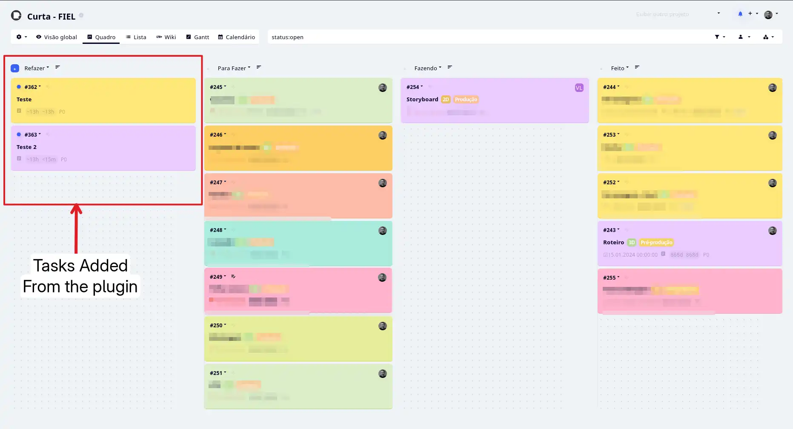
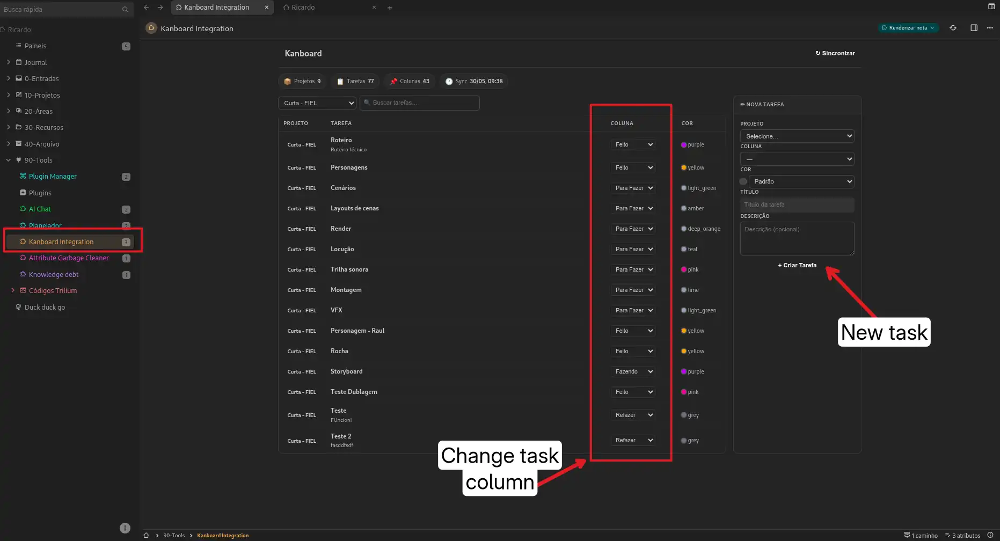
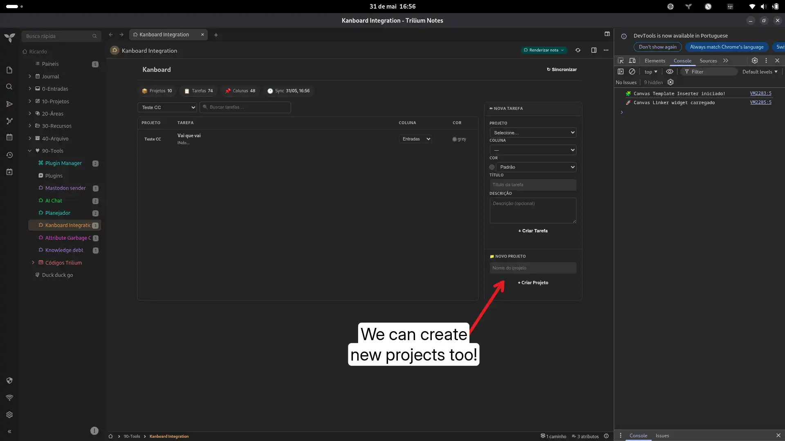
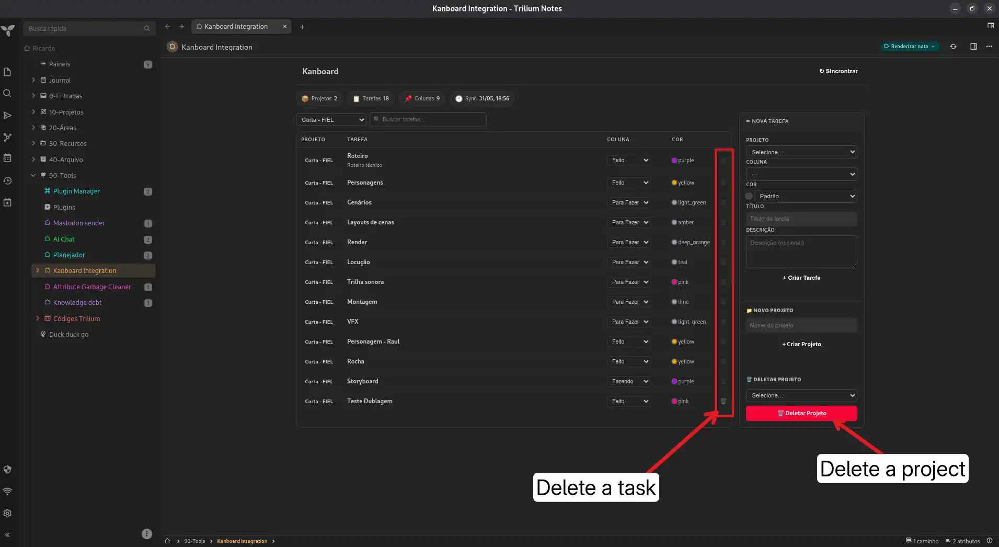

# Kanboard Sync — TriliumNext Render Note

Bidirectional integration between **TriliumNext** and **Kanboard** via the JSON-RPC API. View projects, columns, and tasks — and create new tasks — directly from your notes, without leaving Trilium.

## How it works

```
[JS Frontend (renderNote)] → api.runAsyncOnBackendWithManualTransactionHandling() → Kanboard API (server-to-server)
                                                                                      ↕
                                                                              [JSON cache note]
```

- **Single JS Frontend note** (`Kanboard_Interface.js`): contains all logic — UI, API calls, and cache management. Uses `api.runAsyncOnBackendWithManualTransactionHandling()` to execute backend code securely.
- **JSON cache note** (`kanboard_cache.json`): stores synced data locally for fast access and offline resilience.

API calls to Kanboard are proxied by the Trilium backend (Trilium backend → Kanboard), which avoids CORS and keeps the request headers out of the browser. Note: the token itself is stored in the `CONFIG` object of the **KB Sync** note, so treat that note as a secret (see [Security](#security)).

## Features

- **Dashboard** — visual panel showing projects, columns, and tasks from Kanboard
- **Sync** — fetch all Kanboard data with one click
- **Search** — filter tasks by title or description in real time
- **Filter** — narrow tasks by project via dropdown
- **Move tasks between columns** — inline dropdown on each task row instantly moves it to another column (uses Kanboard's `moveTaskPosition` API)
- **Create projects** — create new Kanboard projects directly from the dashboard; if Kanboard is unreachable the request is queued locally
- **Offline queue** — **project creation** is the only operation queued offline (other actions fail with an error toast and change nothing); the pending badge in the header flushes the queue with one click
- **Delete tasks** — remove tasks with a single click (🗑️ icon appears on hover)
- **Delete projects** — remove entire projects from the dashboard
- **Create tasks** — choose project, column, color, title, and description
- **Responsive** — adapts to screen width, form stacks below tasks on mobile
- **Theme-aware** — uses Trilium's CSS variables, blends with any theme

## Prerequisites

- **TriliumNext** (any recent version)
- **Kanboard** with API enabled (network-accessible)
- API token generated in Kanboard (Settings → API → Create token)

## Installation

### 1. Create the notes in Trilium

Create **3 notes**:

| Note | Type | MIME | Instructions |
|------|------|------|--------------|
| `kanboard_cache` | Code | `application/json` | Paste `kanboard_cache.json` content |
| `KB Sync` | Script | `application/javascript;env=frontend` | Paste `Kanboard_Interface.js` content |
| `Kanboard Integration` | Text | — | Leave blank (this will be your dashboard) |

### 2. Set up the render relation

On the **Kanboard Integration** note, add:
```
~renderNote = KB Sync
```
This makes the dashboard render when you open the note.

### 3. Configure the script

Edit the `CONFIG` constants at the top of the **KB Sync** note:

```javascript
const CONFIG = {
  apiUrl: 'https://YOUR-KANBOARD.com/jsonrpc.php',
  apiToken: 'YOUR_API_TOKEN',
  cacheNoteId: 'ID_OF_CACHE_NOTE',   // ← ID of the kanboard_cache note
};
```

To copy a note ID: right-click on the note → **Copy Note ID**.

### 4. Open the dashboard

Open the **Kanboard Integration** note. Click **↻ Sync** to pull data from Kanboard.

## Usage

### Synchronize

Click **↻ Sync** in the header. All projects, columns, and tasks are fetched and cached locally. If some project fails to load, a toast reports how many were skipped.

### Filter tasks

Use the **"All projects"** dropdown to filter the task table by project.

### Search tasks

Type in the **search box** above the table to filter tasks by title or description in real time, across all projects.

### Move tasks between columns

Each task row has an inline **column dropdown** in the "Column" column. Select a new column and the task is moved instantly via Kanboard's `moveTaskPosition` API. The local cache updates automatically.

### Create a task

Fill out the **New Task** form (right sidebar):
1. Select a **project**
2. Choose a **column**
3. Pick a **color** (optional)
4. Enter a **title**
5. Add a **description** (optional)
6. Click **Create Task**

The task is created in Kanboard and the local cache updates immediately.

## File structure

```
Kanboard-Integration/
├── README.md                 ← This file
├── manifest.json             ← Trilium import manifest
├── kanboard_cache.json       ← JSON cache template
├── Kanboard_Interface.js     ← JS Frontend note (all logic)
├── test-kb.js                ← Unit/structural tests
├── test-smoke.js             ← Headless-Chrome runtime smoke
└── imagens/
    ├── kanboard-2-.webp      ← Screenshots
    ├── kanboard-3-.webp
    ├── kanboard-4-.webp
    └── kanboard-5-.webp
```

## Kanboard API methods used

| Method | Description |
|--------|-------------|
| `getAllProjects` | List all projects |
| `getProjectByName` | Find project by name (prevents duplicates) |
| `createProject` | Create a new project (auto-adds user as member) |
| `getProjectById` | Get project details |
| `getColumns` | List columns for a project |
| `getAllTasks` | List tasks for a project |
| `createTask` | Create a new task |
| `getTask` | Get task details |
| `moveTaskPosition` | Move a task to a different column |
| `getMe` | Get current API user |
| `addProjectUser` | Add user as project member |

Full API docs: [docs.kanboard.org](https://docs.kanboard.org/en/latest/api/)

## Troubleshooting

| Issue | Likely cause | Solution |
|-------|-------------|----------|
| "Error" on sync | Wrong URL or token | Check `apiUrl` and `apiToken` in CONFIG |
| "Configuration required" panel | CONFIG still has the placeholder values | Fill `apiUrl`, `apiToken` and `cacheNoteId` |
| Blank dashboard | Missing `~renderNote` | Add `~renderNote = KB Sync` to the dashboard note |
| No tasks appear | Cache empty | Click **↻ Sync** |
| Delete does nothing | — | Fixed: confirmation now uses an in-page modal (native `confirm()` is blocked in the render-note iframe) |
| "Access Forbidden" | Invalid token | Generate a new token in Kanboard settings |

## Security

The **KB Sync** note holds the Kanboard API token in plain text inside `CONFIG`. Anyone who can read that note can read the token.

- Keep the note private and out of shared/synced trees if the token is sensitive.
- Rotate the token in Kanboard (Settings → API) if it ever leaks.
- If you prefer, store the credentials in a separate note and read them with `api.getNoteContent(...)` instead of hardcoding them.

The panel is bilingual (PT/EN) and picks the language from Trilium's locale.

## Testing

```bash
cd Kanboard-Integration
bun test-kb.js       # unit + structural guards (esc, i18n parity, robustness)
bun test-smoke.js    # headless-Chrome boot smoke (needs Chrome; SKIPs otherwise)
```

## License

MIT

### Screenshot





